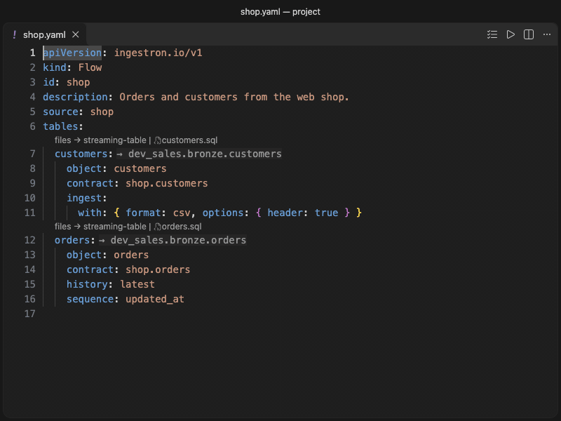
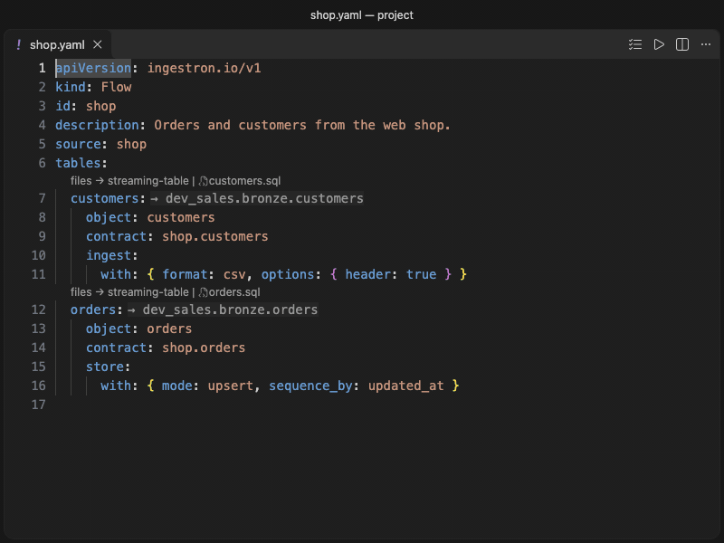

# Ingestron for VS Code

Write Ingestron projects with problems marked as you type, completion that
knows your project, and previews of the files Ingestron generates.


Ingestron turns YAML your team reviews into the files you would otherwise write
by hand: Databricks bundles and pipelines, Azure Data Factory pipelines,
Synapse serverless views and DuckDB SQL, with your organisation's standard
applied. It runs on your machine, never connects to your sources or your cloud,
and never overwrites a file someone edited by hand.

## Write the definitions

A project is a folder of YAML files: connections, flows, contracts and
transforms. The extension reads them as you type.



- **Problems as you type:** a broken link, a setting the standard fixes, a
  method that cannot read a source. Quick fixes repair a broken link.
- **Hover:** says what a setting means and where its value came from.
- **Completion:** offers only what the project allows.
- **Navigation:** go to definition, find references and rename across files.

## See what it generates

Plan lists what would change, Apply writes it, and the files appear in your
project, one set for every environment.



- **Plan, Apply and Check** from the Command Palette, the editor title and the
  right-click menu. Check reports generated files that are out of date.
- **Show generated files** opens what a table becomes, next to its flow.
- **Select environment** chooses the environment the editor shows: problems,
  previews and what each line becomes.
- **Auto-apply** writes the files each time you save, if you turn it on.

New project starts a project from a starter, and the Project and Reference
views sit beside the editor.

Documentation: [docs.ingestron.io](https://docs.ingestron.io/docs/tools/vscode).

## Install

Install [Ingestron from the Visual Studio Marketplace](https://marketplace.visualstudio.com/items?itemName=ingestron.ingestron-vscode),
or search for "Ingestron" in the Extensions view, or run:

```sh
code --install-extension ingestron.ingestron-vscode
```

Open a folder that holds a `project.yaml`, or run **Ingestron: New project**.

## Develop

To build the extension and install your own copy (Node 22.13 or later, pnpm 10):

```sh
pnpm install
pnpm package
code --install-extension ingestron.vsix
```

To work on it:

```sh
pnpm install
pnpm validate          # format, licences, lint, types, bundle, unit tests
pnpm test:integration  # in a downloaded VS Code
pnpm gifs              # record the README's GIFs (run test:integration once first)
```

The editor features (problems, completion, hover, fixes) are plain functions in
[`@ingestron/authoring`](https://www.npmjs.com/package/@ingestron/authoring),
tested without VS Code; `src/vscode/` registers them with VS Code. The bundle
is `dist/extension.cjs`; `scripts/build.mjs` copies the schemas, SQL templates,
ADF recipes and project templates beside it, from the installed packages.

`scripts/gifs.mjs` records `media/readme/definitions.gif` and `outcomes.gif`
from a packaged build in a downloaded VS Code, using projects `ingestron init`
creates. `concept.gif` is brand artwork and comes from outside this repository.

## Privacy

The extension sends no telemetry and makes no network calls of its own. It
reads and writes only the files in your workspace. Questions: privacy@ingestron.io.

## Contact

Questions and feedback: hello@ingestron.io. Security reports: security@ingestron.io
(see [SECURITY.md](SECURITY.md)). Privacy: privacy@ingestron.io.

## Licence

Licensed under the [Apache License 2.0](LICENSE); see [NOTICE](NOTICE).
